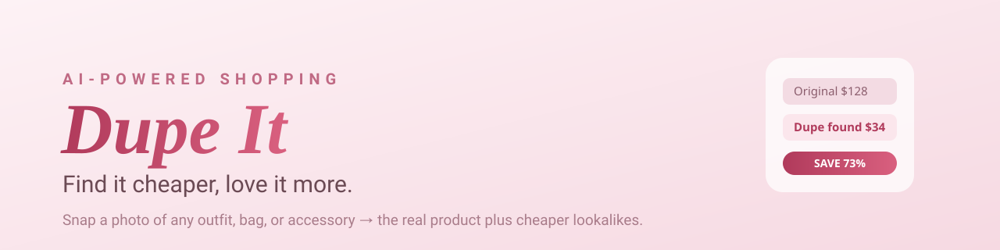

  

<h1 align="center">Dupe It</h1>

<strong>AI-powered shopping — snap a photo, find it cheaper.</strong>

<a href="https://duup-it.vercel.app"><strong>Live app ↗</strong></a>

---

Snap or upload a photo of any outfit, bag, or accessory and **Dupe It** uses AI to
identify the real product, then surfaces cheaper lookalikes — with live prices and
direct buy links. From screenshot to checkout in seconds.

  

## How it works

1. **Capture** — snap a photo or drop in a screenshot of anything you love.
2. **Identify** — AI recognizes the exact item: brand, style, and all.
3. **Compare** — see the real product and cheaper dupes, ranked by price.

## Built with

- Static web front end (HTML / CSS / JS) deployed on **Vercel**
- Serverless API routes powered by the **Claude API** for image understanding
- Live pricing with direct buy links

## Links

- **Live app:** https://duup-it.vercel.app
- **Privacy:** [privacy.html](privacy.html) · **Terms:** [terms.html](terms.html)
